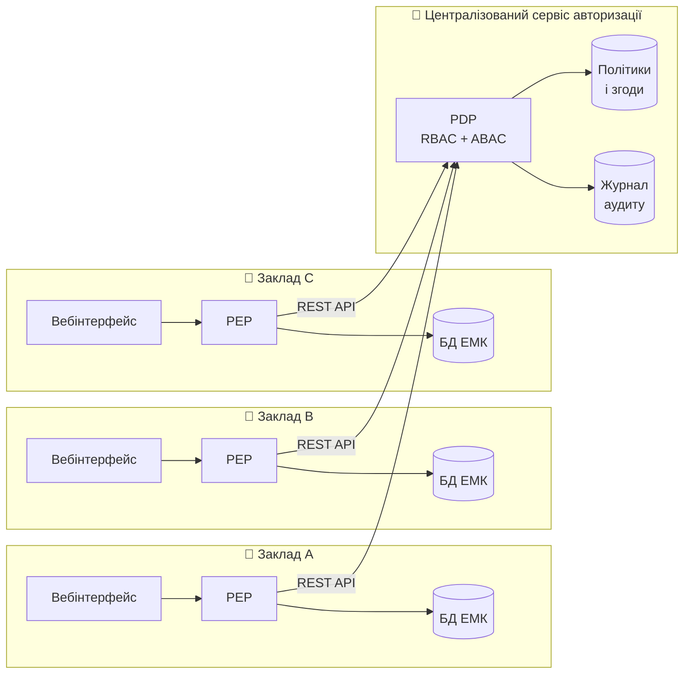

<div align="center">

# 🏥 Med Platform

**Веб-орієнтована інформаційна система електронної медичної карти<br>з гібридною моделлю управління доступом RBAC + ABAC у розподіленому середовищі**

[](https://www.python.org/)
[](https://www.djangoproject.com/)
[](https://www.postgresql.org/)
[](https://docs.docker.com/compose/)
[](LICENSE)

Кваліфікаційна робота бакалавра · спеціальність F3 «Комп'ютерні науки» (122)

</div>

---

## 📌 Про проєкт

Статичні рольові моделі доступу (RBAC) у медичних інформаційних системах не враховують **контекст запиту** — час, заклад, ургентність — і **згоду пацієнта**. Через це лікарям або видають надмірні права, або блокують доступ в екстрених ситуаціях.

Med Platform поєднує рольовий (**RBAC**) та атрибутивний (**ABAC**) підходи: рішення про доступ до медичної карти ухвалюється з урахуванням ролі користувача, атрибутів ресурсу, контексту запиту та згоди пацієнта, а кожна спроба доступу фіксується в журналі аудиту.

> ⚠️ Проєкт використовує лише **синтетичні дані** ([Synthea](https://synthetichealth.github.io/synthea/), HL7 FHIR R4). Реальні персональні та медичні дані не збираються й не обробляються.

## ✨ Можливості

**Реалізовано**

- 👤 Реєстрація та вхід за email, ролі: пацієнт, лікар, адміністратор
- 📋 Профіль пацієнта та медична книга (візити, діагнози, аналізи, призначення, вкладення)
- 🩺 Кабінет лікаря зі списком пацієнтів, які надали доступ
- 🔑 Згода пацієнта: надання й відкликання доступу конкретному лікарю
- ⚙️ Адміністрування лікарів, пацієнтів і записів через Django admin
- 🐳 Розгортання в Docker Compose: backend + PostgreSQL + Nginx (опційно)
- 💾 Щодобове резервне копіювання БД з перевіркою відновлення

**У розробці** (план кваліфікаційної роботи)

- [ ] Централізований сервіс авторизації (PDP/PAP) і точки застосування політик (PEP) на вузлах закладів
- [ ] Гібридна перевірка доступу RBAC + ABAC (роль, заклад, час, ургентність, згода)
- [ ] Екстрений доступ Break-Glass з обов'язковою причиною та обмеженням у часі
- [ ] Журнал аудиту всіх спроб доступу та аналіз підозрілих дій
- [ ] Розподілене розгортання: 3 вузли медичних закладів + сервіс авторизації
- [ ] Порівняльний експеримент RBAC / ABAC / гібридна модель

## 🏗️ Цільова архітектура



Кожен запит лікаря до медичної карти перехоплює **PEP** вузла закладу й надсилає на **PDP**, який ухвалює рішення «дозволити / відмовити» за ролями, атрибутами та згодою пацієнта.

## 🧰 Технології

| Шар | Технології |
| --- | --- |
| Backend | Python 3.12, Django 5.0, Django REST Framework |
| База даних | PostgreSQL 16 (SQLite — для швидкого локального запуску) |
| Вебсервер | Gunicorn, Nginx (опційно), WhiteNoise для статики |
| Інфраструктура | Docker, Docker Compose |
| Дані | Synthea, HL7 FHIR R4 (синтетичні) |

## 🚀 Швидкий старт

### Через Docker (рекомендовано)

```bash
git clone https://github.com/Illia2509/scientific-work.git
cd scientific-work
cp .env.example .env          # задайте власні SECRET_KEY і DB_PASSWORD
docker compose up --build
```

Створіть адміністратора в окремому терміналі:

```bash
docker compose exec web python manage.py createsuperuser
```

| Адреса | Що там |
| --- | --- |
| http://localhost:8000 | Сайт |
| http://localhost:8000/admin/ | Адмін-панель Django |

**З Nginx** (сайт на порту 80, статику віддає Nginx):

```bash
docker compose --profile nginx up --build
```

### Без Docker

Якщо в `.env` не задано `DB_HOST`, використовується SQLite.

```bash
python -m venv .venv
source .venv/bin/activate     # Windows: .venv\Scripts\activate
pip install -r requirements.txt
cp .env.example .env          # видаліть рядок DB_HOST
python manage.py migrate
python manage.py createsuperuser
python manage.py runserver
```

## ⚙️ Змінні оточення

Усі налаштування задаються у файлі `.env` (шаблон — [`.env.example`](.env.example)). Файл `.env` не потрапляє в Git.

| Змінна | Призначення | Приклад |
| --- | --- | --- |
| `DEBUG` | Режим розробки | `True` лише локально |
| `SECRET_KEY` | Секретний ключ Django | згенеруйте власний |
| `ALLOWED_HOSTS` | Дозволені домени | `127.0.0.1,localhost` |
| `CSRF_TRUSTED_ORIGINS` | Довірені джерела для форм | `http://localhost` |
| `DB_NAME`, `DB_USER`, `DB_PASSWORD` | Доступ до PostgreSQL | — |
| `DB_HOST`, `DB_PORT` | Адреса БД | `db`, `5432` |
| `BACKUP_KEEP_DAYS` | Скільки днів зберігати резервні копії | `7` |

Згенерувати `SECRET_KEY`:

```bash
python -c "import secrets; print(secrets.token_urlsafe(50))"
```

## 💾 Резервне копіювання

Сервіс `backup` раз на добу виконує `pg_dump` у папку `./backups` і видаляє копії, старші за `BACKUP_KEEP_DAYS`.

```bash
# зробити копію вручну
docker compose exec backup sh /scripts/backup.sh

# перевірити відновлення останньої копії
docker compose exec backup sh /scripts/restore_check.sh

# відновити робочу БД з копії
docker compose exec backup pg_restore --clean --if-exists --no-owner -d med_platform /backups/<файл>.dump
```

## 📁 Структура проєкту

```
scientific-work/
├── apps/
│   ├── users/            # користувачі та ролі (patient, doctor, admin)
│   ├── medical/          # профілі, медичні записи, вкладення
│   ├── access_control/   # доступ лікаря до карти пацієнта (згоди)
│   └── core/             # головна сторінка, службові команди
├── config/               # налаштування Django
├── templates/            # HTML-шаблони
├── static/               # стилі
├── nginx/                # конфігурація Nginx
├── scripts/              # резервне копіювання й перевірка відновлення
├── docker-compose.yml
├── Dockerfile
└── requirements.txt
```

## 🔒 Безпека

- Секрети (`SECRET_KEY`, `DB_PASSWORD`) — лише в змінних оточення, у репозиторії тільки шаблон `.env.example`
- Без `SECRET_KEY` сервер не запуститься поза режимом розробки
- Застосунок у контейнері працює від непривілейованого користувача
- Перевірка на витік секретів: `gitleaks detect --source . -v`
- Використовуються лише синтетичні дані

## 🎓 Про роботу

| | |
| --- | --- |
| **Автор** | Бредіхін Ілля Володимирович, група 4CS-41 |
| **Керівник** | Терлецька Марія Сергіївна |
| **Тип роботи** | Програмна інженерія з елементами дослідження |
| **Рік** | 2026–2027 |

## 📄 Ліцензія

Код поширюється за ліцензією [MIT](LICENSE).
